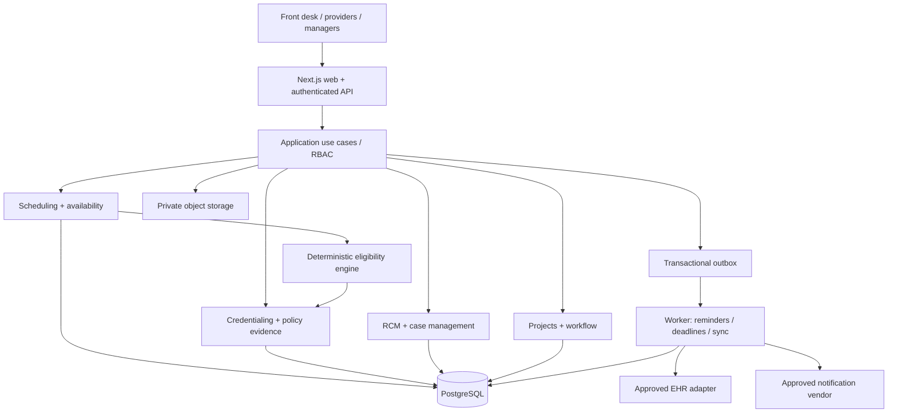
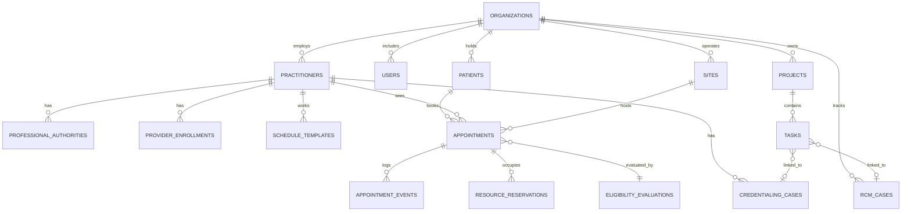

# ProjectOS Health — Complete Product, Architecture & Execution Blueprint

**Edition:** 2.0 — single-organization-first, SaaS-ready, license-aware scheduling  
**Prepared:** 2026-10-20  
**Intended recipient:** Claude Code / Codex / engineering team  
**Product state:** specification only; no production application or regulatory approval is implied  
**Priority:** a real, testable working application at minimum reasonable cost

> **MANDATORY SAFETY GATE** — Patient scheduling data (including identifiable patient names linked to appointment details) can be protected health information. Until the organization formally approves its compliance program, has the necessary BAAs, performs a security risk analysis, and completes the security and operational go-live checklist, use **only synthetic patient data**, including screenshots, seed data, logs, tests, demos, and AI prompts. The code may be designed for PHI, but that does not authorize processing it. No AI model, analytics service, email vendor, monitoring vendor, or hosting product is PHI-safe merely because it is popular or encrypted.

---

## 0. Decision record / non-negotiable constraints

1. Build one deployment for **one real organization**, with multiple sites, departments, providers, care teams, calendars, payers, and staff. No multi-organization self-signup or billing in version 1.
2. Include `organization_id` throughout data structures **now** and enforce authorization boundaries even with one organization; enable organization provisioning and commercial billing later.
3. Build a **modular monolith**, not microservices, using one PostgreSQL database and a shared background-job framework. No Kubernetes, event bus, paid search platform, separate mobile app, or AI agent fleet at MVP.
4. The core product combines **provider/patient scheduling + licensure/credentialing + revenue-cycle workflows + project/task management**. Scheduling is not an afterthought.
5. All scheduling decisions are derived from a **deterministic policy engine**, not an LLM. AI may explain, summarize, and propose, but cannot grant licensure, waive a compliance block, or write clinical instructions.
6. **Default deny** when professional eligibility information is absent, expired, conflicting, unverified, unsupported, or requires legal interpretation. Authorized compliance staff can record externally verified permissions as controlled evidence with expiry and audit; they cannot make a bare, unaudited unrestricted override.
7. The booking engine must prevent double-booking at **database transaction level**. Frontend conflict checks alone are insufficient.
8. Patients' **physical location at the appointment time** (especially telehealth) is captured and confirmed. Residence, phone area code, and mailing address do not substitute for actual location. Provider's physical location and originating/destination jurisdiction requirements are modeled when relevant.
9. Payor network participation, payer authorization, EHR sync health, service restrictions, and provider licensure are **distinct eligibility dimensions**, independently reported.
10. Every significant workflow has a user interface, API, persistence, activity/audit records, and tests. Avoid decorative mock dashboards with fake actions.
11. Do not start real patient bookings until **PHI-readiness and EHR-source-of-truth** gates pass. Synthetic-data staff pilot may begin earlier.
12. Keep common flows fast: organization setup <15 minutes, scheduling search <3 clicks after filters, task creation <30 seconds, key pages responsive on a standard laptop.
13. Keep dependencies minimal, favor mature open-source packages with maintained licenses and security practices; pin versions and review advisories at implementation time.
14. Human approval is mandatory for changes to license policy, bulk rescheduling, outbound patient communications, payer-sensitive decisions, data export, and destructive operations.
15. Maintain migration, backup, and restore procedures from the first deployable version, not after data loss.

### 0.1 User-visible promise

> ProjectOS Health puts healthcare operations on one dependable system: plan work, track credentialing, schedule the right provider in the right jurisdiction, coordinate follow-up, and see risks before patients or staff are affected.

### 0.2 Explicit exclusions from first live release

- Full EHR/EMR: charts, diagnoses, orders, prescriptions, clinical decision support, progress notes, chart signing.
- Native video conferencing or real-time virtual care sessions.
- Electronic claims clearinghouse, X12 837/835 processing, payment posting, bank transfers.
- Automated insurance eligibility / authorization unless a separately approved integration exists.
- Autonomous legal/licensing determinations from scraped websites, AI, or state compact membership alone.
- Patient portal, unsupervised self-scheduling, intake questionnaires, patient messaging, or public API until their security and safety flows are validated.
- Complex financial ERP, payroll, payroll timeclock, BI warehouse, native mobile apps, subscription billing, or multi-region HA.

**Phase distinction:** a synthetic scheduling demonstration is not production patient scheduling. A real scheduling pilot needs PHI compliance approval and integration/operational safeguards even if only one organization uses it.

---

## 1. Vision, users, measurable outcomes

### 1.1 Target customers

Initial: federally qualified health centers (FQHCs), community health centers, multi-location primary care and behavioral health organizations. Later: specialty groups, dental, community health networks, managed services and broader business project management verticals.

### 1.2 Personas, access, and primary job-to-be-done

| Persona | Primary work | Baseline scope |
|---|---|---|
| Organization administrator | Configure organization, users, sites, roles, master data | Global; least privilege |
| Scheduling manager | Configure templates, exceptions, cancellation rules, resources | Scheduling department |
| Scheduler/front desk | Search availability, book, change/cancel, waitlist, check in | Allowed locations and patient data |
| Provider | See own calendar, blocks, requested changes, license/readiness alerts | Own provider schedule; restricted patients |
| Credentialing specialist | Maintain licenses, payer enrollments, affiliations, expiring requirements | Provider/credentialing records |
| Credentialing approver | Verify credentials and approve verified authority records | Controlled compliance actions |
| Revenue cycle supervisor | Set work-queue rules, assign work, review aging/denials | RCM department |
| Billing/follow-up analyst | Work assigned cases, comments, due dates, outcomes | Assigned queues |
| Project manager | Create projects, boards, deadlines, task dependencies | Assigned projects |
| Executive/quality officer | Cross-department KPIs, blockers, staffing and risk summaries | Aggregate minimum-necessary |
| Auditor/compliance officer | Read tamper-evident logs, investigate exceptions, export with approval | Purpose-bound access |
| Read-only observer | View expressly shared non-PHI summaries | Minimal |

### 1.3 Target initial operating scale / performance

Design baseline, **not claimed existing users**: up to 100 staff accounts, 100 providers, 20 sites, 50 appointment types, 500 appointments/day, 50,000 appointments/year, 15,000 operational tasks, and 10 concurrent scheduling editors. These are engineering test assumptions. Revisit with actual pilot data.

- p95 schedule search <=2 seconds for a 14-day window under test baseline; p95 save/reschedule <=1.5 seconds excluding external EHR/notifications.
- Zero duplicate confirmed active bookings for a provider when concurrency tests race.
- Every booking has an explicit eligibility evaluation ID and policy snapshot.
- All state restrictions have visible reason codes; no ambiguous green 'eligible' without evidence.
- 100% of sensitive mutations create audited records.
- WCAG 2.2 AA-oriented keyboard and accessible interaction goals; explicitly test common flows.

### 1.4 Business KPIs

Scheduler: time-to-next-available, provider utilization, slot fill, same-day availability, no-show rate, cancellations and rebooks, scheduling conflict rate, preventable blocked-booking attempts, waitlist conversion, unassigned appointment requests, patient state verification rate. Credentialing: expiring licenses, pending affiliations, average payer approval time, days to ready-to-schedule, provider readiness by location and payer. RCM: worklist throughput, high-priority aging, denied-claim initiative progress, days since last follow-up, case resolution rate. Project: due-date adherence, overdue ratio, blockers, cycle time, planned vs actual milestones.

Metrics must display numerator, denominator, filter dates, data freshness, and source; avoid inventing operational performance.

---

## 2. Feature catalog and required behavior

### 2.1 Cross-cutting project and workflow engine (P0)

- Organizations (seed one), sites, departments, teams, staff invitations, roles and granular permissions.
- Projects, templates, tasks, nested subtasks (limit initial depth to 2), assignee(s) (one accountable owner), reviewers, status, priority, tags, due date, checklist, comments, attachments, links and timeline events.
- Default views: My Work, Board, Table, Calendar; project overview with milestones and blocked work. Drag-and-drop Kanban persisted; manual status edit accessible without drag.
- Dependency (`BLOCKS`, `RELATED`), cycle prevention, blocked status derived from unmet blocking dependencies; no advanced resource leveling first.
- Saved filters, search, bulk actions limited to safe selections with confirmation, task history, duplicate task detection heuristics.
- Department templates, recurring tasks (idempotent scheduler), automation triggers for due-soon, overdue, status changes and credential renewal.
- Approvals requiring an authorized user; approval is separate from moving a task to `DONE`.
- Real notifications inside app first, outbound email after vetted provider configuration; digest and quiet-hour preferences.

**Example:** 'Complete provider Maryland licensure review' is both a credentialing workflow step and an actionable task assigned to a specialist. Status should stay in sync via domain events/jobs, not manual dual entry.

### 2.2 Patient/provider scheduling engine (P0)

**Configuration:**
- Sites: name, time zone (IANA), physical address/state, service lines, hours, closures and holidays.
- Practitioners: identity, profession, subspecialty, identifiers, affiliated sites, languages, active/inactive, telehealth modality capability, permitted services.
- Appointment types: new patient, established, follow-up, annual, behavioral intake, therapy follow-up, urgent (template only), other; duration, buffer, allowed modalities, booking notice, days-out, lead time, insurance rules, resource requirements, age restrictions when relevant.
- Template per practitioner/location/day-of-week, recurring working hours, breaks, vacation/time off, temporary coverage, overbook permission policy (disabled by default), and availability exceptions.
- Rooms and equipment inventory, location-specific rooms, capacity and closure windows.

**Operations:**
- Scheduler-oriented day/week views across one or multiple providers and sites, with optional room view; local time labels and accessible status legend.
- Search by patient-state, appointment type, specialty, modality, desired date, site, provider, preferred language, existing/new status, payer; every result explains why eligible.
- Create appointment, temporarily hold slot, confirm, reschedule, cancel with reason, check in, mark arrived/completed/no-show (according to authorized workflow), record follow-up requested; send notifications asynchronously and safely.
- Appointment details with provider, scheduled site, encounter modality, patient location at time, booking channel, data source, readiness snapshot, history.
- Waitlist with requested date range, service, priority entered by staff, preferred locations and provider, offered/expired/accepted/declined lifecycle; no auto-commit without policy.
- Conflict warnings: provider occupied, room occupied, closure, unsatisfied buffer, work-hour mismatch, licensed jurisdiction, payer affiliation, booking horizon, excluded service, appointment-type mismatch, external EHR uncertainty.
- Provider-requested time off: approve -> identify impacted appointments -> schedule manager reviews reschedule batch -> process individually with logs.
- Booking reschedule is an atomic transition; if failed, original booking remains unchanged.
- Date/time stored UTC; all local calendar display uses location/practitioner timezone; explicit handling of DST gaps/overlaps.

**Patient identity and privacy:**
- Minimal patient index: internal UUID, organization patient ID / source EHR ID, preferred display name, DOB or age-category only if clinically necessary, contact channels and consent status; restrict DOB/addresses to minimum necessary.
- For synthetic mode, generate unmistakably fake persons (e.g. `DEMO-0001`) and do not upload real exports to seed.
- Patient duplicate detection by reliable external identifier first; manual reconciliation UI later; never merge two patient records automatically.
- Patient state is stored **per appointment and per visit check-in**, independent from demographic residence. Proposed state may differ from confirmed state.
- Telehealth check-in requires location confirmation, subject to policy and operational exceptions; if different from booked state, reevaluate and block until valid.
- Provider physical location for telehealth may matter to the applicable authorization; capture and evaluate where policies require it.

**Separate status dimensions:**
```
appointment.status = HOLD | PENDING | CONFIRMED | CHECKED_IN | COMPLETED | NO_SHOW | CANCELLED | NEEDS_RESCHEDULE
license_review.status = VERIFIED_ELIGIBLE | VERIFIED_INELIGIBLE | NEEDS_VERIFICATION | EXPIRED | POLICY_UNAVAILABLE
payer_readiness.status = READY | NOT_READY | UNKNOWN | NOT_REQUIRED
sync_state = SYNCED | PENDING | ERROR | CONFLICT | STANDALONE
```
Do not collapse appointment lifecycle and provider/payer licensing states into a single field.

### 2.3 License-aware eligibility: formal decision model (P0)

At candidate-slot search, booking commit, reschedule, check-in and encounter commencement (if controlled), call a **single centralized EligibilityService**. Evaluate for date/time and effective version of rules and facts; capture source evidence and review dates. Telehealth license authority is not automatically established from provider address or interstate compact participation.

**Inputs (`EligibilityContext`):**
- organizationId, candidate practitionerId and profession taxonomy, specialties
- serviceType / appointmentType, modality (IN_PERSON, VIDEO, AUDIO_ONLY), planned local/UTC time
- patient actual/proposed location jurisdiction at appointment time (state/territory; optionally country), verification source/time
- provider physically located state/country as needed
- site location, selected site/provider affiliation
- independently configured licenses, permits, compact privileges/authorizations, exceptions, expiration, suspensions, verified statuses
- currently effective, compliance-approved policy rules with state, profession, service, mode, conditions, dates and evidence
- payer/plan/network and active payer enrollment/affiliation (if required for desired plan)
- open clinical/admin restrictions, capacity, calendar and resource constraints
- EHR sync policy and latest external master-schedule sync timestamp

**Output:**
```
{
  decision: 'ALLOW' | 'BLOCK' | 'REVIEW',
  canConfirm: boolean,
  flags: [{ code, dimension, message, remediation, severity }],
  policyVersion: string,
  evaluatedAt: ISODateTime,
  validForInstant: ISODateTime,
  evidenceIds: string[],
  patientLocationStatus: 'PROPOSED' | 'VERIFIED' | 'UNKNOWN',
  ruleEffectiveDate: ISODate,
  nextRequiredReviewAt: ISODateTime | null
}
```
**Rules:**
1. Missing/inexact patient location at booking: `REVIEW`, no routine confirmation if location is required. Never assume mailing address proves location.
2. No verified legal authority applicable to profession + patient state + service + modality + effective date: `BLOCK` if clearly unauthorized, otherwise `REVIEW` until appropriate determination; either way `canConfirm=false`.
3. An expired, suspended or unverified credential cannot authorize an appointment. A valid license does not by itself prove correct payer participation.
4. State-specific exemptions (e.g. temporary practice/continuity) can be modeled only with explicit approved exception record, governing authority, applicability conditions, evidence, reviewer, valid window, and task to revisit.
5. Medical Interstate Licensure Compact (IMLC) generally expedites **separate state licenses**, not a blanket single multistate medical license. Do not model IMLC membership as licensure approval.
6. Nurse Licensure Compact multistate authority is distinct, applies only for appropriate license types/states and conditions; an RN compact rule cannot be generalized to advanced practice or unrelated professions.
7. PSYPACT telepsychology involves active authority (e.g. APIT), and state/physical location restrictions; participating-state map alone is insufficient.
8. Providers may have discipline, supervision, payer panel, age/service, and organizational restrictions independent of license record.
9. If patient location changes on day of visit: recheck immediately. If required authority not established, do not proceed through routine workflow; escalate to designated staff.
10. If compliance has not approved a policy covering the context or evidence is stale: `REVIEW`. Do not pretend this is a fully autonomous legal determination.
11. Admin UI shows exact reason, missing items, source, last verified, reviewer and remediation; do not reveal unrelated patient information in policy error messages.
12. Safety-critical changes to policy facts require dual control or designated authorized approval and audit.

**Eligibility UX copy:**
- `Eligible to book — Virginia license verified through 2027-03-31; site and payer participation confirmed as of 2026-10-18.`
- `Blocked — provider's verified Maryland authority expired 2026-09-30.`
- `Needs verification — patient's location at time of video visit is not confirmed.`
- `Needs verification — PSYPACT authorization evidence not available for this provider and destination state.`
- `Cannot offer — another confirmed appointment occupies this provider and time.`

These are **illustrative** status examples; the implementation must derive dates and reasons from real signed-off data, never hardcode them.

### 2.4 Credentialing and licensure (P0)

- Practitioners and specialties, professional identities and practice-state authorization records; NPI (where applicable), internal IDs and encrypted/limited sensitive fields.
- Credential documents with issuing authority, credential type, state, effective/expiration dates, license number (mask as appropriate), verification URL/source, verification date, verified-by and next revalidation due.
- Credential validity states: draft, submitted for review, verified, rejected, expired, suspended, revoked, pending clarification.
- Payer master data, payer product/network, organization agreements, site/provider affiliations; treat participating network-specific approvals separately.
- Enrollment cases per provider + payer + plan + site; received/submitted/awaiting request/approved/denied/terminated lifecycle and dates.
- Checklist templates for applications, supporting docs, recredentialing; generated tasks, escalations, owners and milestones.
- Eligibility-linked readiness matrix: provider × site × service × state × modality × payer with underlying evidence.
- Expiration alerts at configurable 90/60/30/14/7 days; idempotent notices and no duplicate tasks.
- Retro-effective dates are displayed separately from confirmation dates. Avoid treating 'application submitted' as 'approved'.
- **Approvals and source verification must be recorded manually by authorized staff** in MVP. No fabricated verification from state licensing sites.

### 2.5 Revenue cycle operations (P0)

**Work management, not a claims engine.**
- RCM work queues (denial review, claim follow-up, authorization/eligibility issues, payer escalation, refunds, aging initiatives, corrected-claim projects).
- Cases with synthetic/reference ID, payer, assigned staff, work category, priority, due dates, days outstanding, current status, reason tags, amounts if needed, next action, last action date, links to tasks, comments, file references; patient-identifiable claim data only after approved PHI readiness.
- Rules to assign workload evenly or by policy, configurable claims/contact follow-up dates, overdue notifications, reversible bulk assignment with audit.
- Queue status and productivity metrics; manual CSV import for **synthetic/de-identified** pilot data only, with source provenance and validation.
- Healthcare policy/business-rule templates are configurable, not universally baked-in (e.g. timely filing varies by payer and contract).
- Optional later integrations for EHR/clearinghouse; no unverified direct payer or claim submission.

### 2.6 Executive dashboard and reports (P0/P1)

Dashboard tiles: today's appointments, available slots, possible appointment conflicts, unresolved licensure reviews, licenses expiring soon, providers missing payer affiliation, overdue credentialing cases, open RCM work, overdue tasks, critical projects. Filter by site, department, service, status, date and provider. Access to PHI is permission-controlled; aggregate views hide individual patient details unless essential. Every tile has a clickable drill-down with same filters and verified counts.

### 2.7 Workflow automation / AI (P1)

Start with **deterministic automation**: schedule-based reminders, threshold alerts, renewal tasks, blocked-case escalations, overdue and status transition notifications; template builder with trigger → condition → action.

Later add opt-in AI assistant for **operational, nonclinical tasks**: convert meeting notes to tasks, summarize non-PHI project statuses, suggest RCM queue priority, identify licensing evidence gaps, prepare drafts for authorized review, describe why a slot was blocked based on engine reason codes. No AI override for licensure or patient booking; **no PHI to an AI provider without approved BAA and service-scope controls**. All AI outputs must cite internal data IDs/snapshots, state uncertainty, and require human confirmation for writes.

---

## 3. User journeys / acceptance scenarios

### 3.1 Scheduling an in-person appointment

1. Authorized scheduler selects patient or creates a synthetic profile.
2. Selects appointment type, desired location and date window, payer if applicable.
3. System returns eligible providers/slots after resource, calendar, service, site and license checks.
4. Scheduler clicks slot, sees accessible conflict/status explanation and any missing prerequisites.
5. Save performs **server-side re-evaluation** inside transaction and enforces database no-overlap.
6. Confirmed appointment appears on provider and site calendars immediately, with immutable audit event and optional internal notification.
7. On cancellation, slot becomes available and waitlist suggestions can be generated.

### 3.2 Telehealth with patient traveling to another state

1. Existing patient demographic home is Virginia; patient plans video appointment while in Maryland.
2. Scheduler explicitly enters `visit_location_state=MD`, `location_verification=PROPOSED`, mode VIDEO.
3. System evaluates MD-specific authorization for profession, service, modality, provider location and date.
4. If no verified authority, provider is excluded or shown disabled with reason; may show alternate authorized clinician.
5. Credentialing team receives an actionable review task when allowed and policy-defined.
6. When eligible, scheduler may reserve/confirm according to location-verification policy.
7. At check-in patient confirms being in DC instead; system re-evaluates against DC jurisdiction. If now unauthorized or uncertain, visit is stopped from routine progression and escalated; record audit and disposition.

### 3.3 Credentialing to scheduling readiness

1. Specialist records provider and license with supporting verification evidence.
2. Reviewer validates professional authorization; policy engine marks appropriate jurisdictions as ready.
3. Payer enrollment is pending at Site A. Commercial-payer slots requiring that enrollment remain unavailable even if state license is valid.
4. Approval received and verified with effective date; payer-site linkage changes readiness; queue task closes with audit.
5. Scheduling availability recalculates; previously blocked booking must be retried; do not auto-book patients.

### 3.4 Concurrent slot booking

Schedulers A and B see same 10:00 AM slot. Both submit within milliseconds. Exactly one booking succeeds; the other receives an accessible `409 SLOT_CONFLICT`, alternative slots, and no patient reminder. DB constraint prevents duplicates even if UI cache is stale.

### 3.5 RCM improvement project

Manager opens `Reduce >90-Day A/R` project, creates milestones and assigned queue tasks; team updates outcomes; dashboard shows real open/closed counts and stalled cases; credentialing blockers can be linked without duplicating records.

### 3.6 Waitlist

Patient requests behavioral follow-up Tuesday–Friday after 2 PM with eligible providers. A cancellation produces matching slot suggestion; scheduler verifies state/payer readiness at offer and again at confirm. Offers expire and release; never automatically assign a previously invalidated provider.

---

## 4. Detailed technical architecture

### 4.1 Recommended stack: low-cost, proven, AI-agent-friendly

- **Monorepo**: pnpm workspaces, TypeScript, consistent lint/type/test.
- **Web + HTTP app**: Next.js App Router (React), server-side handlers for UI/BFF; a dedicated business service layer within the same deployable codebase, no mandatory NestJS process at MVP. This **reduces hosting and operations cost** while preserving domain modularity. If scale warrants, extract a module later.
- **UI**: Tailwind CSS, shadcn/ui/Radix primitives, Lucide; React Hook Form + Zod; TanStack Table; accessible calendar/time grid; optionally FullCalendar with verified appropriate licensing, or build focused scheduling grid with OSS primitives. Do not assume all advanced calendar components are free for commercial use.
- **Database**: PostgreSQL 16+; Drizzle ORM or Prisma (select one by Phase 0; recommended **Drizzle** for visibility into PostgreSQL constraints, or Prisma plus raw SQL migrations for range exclusions). No SQLite in deployed system because PostgreSQL exclusion constraints are a requirement.
- **Authentication**: mature maintained auth framework with secure httpOnly cookie sessions and RBAC; passkey/MFA rollout before PHI go-live; do not hand-roll cryptographic auth.
- **Background processing**: DB-backed job/notification outbox for prototype (no Redis requirement); use a short-lived worker polling Postgres with `FOR UPDATE SKIP LOCKED` and idempotency. Migrate to Redis/BullMQ when load justifies it. If only one web process, background worker may be separate supervised process on same VM.
- **Storage**: local disposable fake uploads for dev; private S3 with signed short-lived access for PHI-approved deployment; no public bucket or public file URL.
- **Deployment**: `docker compose` for local development with postgres/web/worker. For non-PHI online demo, single small VM using Docker Compose and HTTPS reverse proxy. For PHI, formally designed AWS environment using only HIPAA-eligible services, AWS BAA, audit/logging, security ownership and backup/restore. Prefer a single appropriately sized EC2 + encrypted EBS + S3 + SES initially only after security review; RDS later if budget supports it. This is **not** inherently compliant by architecture alone.
- **Telemetry**: structured logs with request ID and redaction, basic metrics and health checks; no patient names, full request bodies, session tokens, license numbers, or appointment notes in logs.
- **CI**: GitHub Actions lint, typecheck, unit, integration, migration checks and E2E synthetic tests; deploy only passing main branch commits; private repository.
- **APIs**: REST/JSON + OpenAPI definitions and generated TypeScript client schema; version `/api/v1`; internal domain events/outbox.
- **Interoperability**: plan mapping to HL7 FHIR R4 `Patient`, `Practitioner`, `PractitionerRole`, `Location`, `HealthcareService`, `Schedule`, `Slot`, `Appointment` (mapping layer, not automatic FHIR-compliant server). Support vendor-specific adapter and field map.

### 4.2 Architecture diagram



### 4.3 Module boundaries

```
apps/web                  # Next.js routes, UI, API handlers
apps/worker               # Node worker / cron polling
packages/db               # ORM models, migrations, constraints, seeds
packages/auth             # login, session, permissions
packages/core             # org/sites/staff/projects/tasks/events
packages/scheduling       # calendars, templates, booking, waitlist, resources
packages/licensing        # policy decisions, evidence, rule versions
packages/credentialing    # practitioners, licenses, payer affiliations
packages/rcm              # work queues, cases, assignments
packages/notifications    # inbox, delivery queue, templates
packages/integrations     # EHR adapter interfaces + stubs
packages/ui               # design system, accessible components
packages/shared           # typed contracts, validation, errors
```

**Import rule:** domain modules depend on shared contracts and repositories; `scheduling` can call `licensing` and `credentialing` public service interfaces; domain services must not import Next.js components or rely on the browser. Prevent circular dependencies with compile-time architectural lint checks.

### 4.4 Tenant model: one organization now, multiple later

- `organizations` has one seed record; all domain tables include non-null `organization_id` and compound unique/index design.
- Every authenticated request resolves organization membership from the trusted session. **Never trust client-supplied `organization_id`.**
- Backend queries always constrain organization and applicable patient/department/site permissions. Consider PostgreSQL RLS as defense-in-depth for sensitive tables and test session context carefully.
- Composite foreign keys `(organization_id, referenced_id)` or equivalent validations guard accidental cross-organization joins.
- Never put `tenant_id` into an untrusted URL and assume that provides authorization.
- Future organization switcher, billing, cross-tenant admin and tenant provisioning are feature-flagged OFF.

### 4.5 Source-of-truth / EHR integration strategy

If an existing EHR scheduling system is operational, **do not create competing confirmed calendars without a reconciliation plan.** Choose one mode per site:

- `DEMO`: synthetic, no real patients.
- `STANDALONE_APPROVED`: ProjectOS is official scheduling source following clinical and compliance signoff, with defined staff procedures.
- `EHR_MASTER`: the EHR is official booking source; ProjectOS reads availability and writes through a verified adapter, awaits EHR confirmation, and reconciles failures.
- `READ_ONLY`: ProjectOS imports approved metadata for reporting and suggests scheduling but does not create authoritative appointments.

Adapter contract: `getProviders`, `getLocations`, `getAvailability`, `searchPatients`, `createAppointment`, `updateAppointment`, `cancelAppointment`, `getAppointmentByExternalId`, `pullChanges(since)`, plus health/readiness checks. Not every vendor supports every operation. Gate each capability individually; no silent fake sync.

**Every external write**: idempotency key, mapping row with source ID/version/etag, retry with exponential backoff, dead-letter queue, reconciliation job, failure status visible to staff, no duplicate booking. If EHR is authoritative and unavailable or freshness threshold exceeded, **fail closed** for confirmation, offer saved draft/queue for later.

---

## 5. Database design, entity catalog and invariants

### 5.1 Standard columns

Tables have `id UUID PRIMARY KEY`, `organization_id UUID NOT NULL` where applicable, `created_at`, `updated_at`, `created_by`, optional `deleted_at`, `version INT NOT NULL DEFAULT 1`. Patient/credential/audit sensitive tables require data classification in schema docs. Use UTC `timestamptz` for instants and `date` for actual date-only values. Store full IANA zone ID in site and appointment where applicable. UUIDs do not substitute for referential validation. Prefer soft delete for workflows with history, but never reuse an identifier accidentally.

### 5.2 Main entity catalog

| Domain | Table | Important fields, constraints |
|---|---|---|
| Org | `organizations` | name, legal_name, slug, status, settings_json, timezone |
| Org | `sites` | organization_id, code, state, IANA timezone, physical address, active |
| Org | `departments`, `teams` | site associations, scope |
| Identity | `users` | normalized email, status, MFA flags, provider link optional |
| Identity | `memberships`, `roles`, `permissions`, `role_grants` | org/site/department scopes; least privilege |
| Patients | `patients` | source EHR ID, internal MRN, minimal demographics, restricted PII |
| Patients | `patient_contacts`, `patient_consents` | channel, opt-in/opt-out, verified timestamps |
| Providers | `practitioners` | profession taxonomy, specialty, staff user optional, active |
| Providers | `practitioner_sites`, `practitioner_services` | provider/site/services and availability flags |
| License | `professional_authorities` | practitioner_id, profession, jurisdiction, authority_type, number masked/encrypted, active dates, verification state |
| License | `authority_verifications`, `authority_documents` | source URL, reviewer, reviewed date, evidence key, expiry, immutable history |
| License | `license_policy_rules` | rule version, profession, jurisdiction, modalities, conditions, effective dates, approval metadata, status |
| License | `authorization_exceptions` | permitted basis, evidence, scope, time window, reviewer, approval, restrictions |
| License | `eligibility_evaluations` | input hash, result, reasons, version, evidence snapshot, subject IDs, expiration |
| Payers | `payers`, `payer_plans`, `provider_enrollments` | payer-plan, provider, site, service, effective dates, verified approval |
| Credentialing | `credentialing_cases`, `credential_requirements` | enrollment workflow, assigned owner, status, follow-up date, approval evidence |
| Scheduling | `appointment_types` | duration, buffers, modality, service, visit rules |
| Scheduling | `schedule_templates`, `schedule_rules` | recurrence, weekday, site, timezone, provider, start/end local times |
| Scheduling | `schedule_exceptions` | PTO, holidays, closures, ad hoc availability, approver |
| Scheduling | `rooms`, `equipment` | site, type, capacity |
| Scheduling | `resource_reservations` | resource_type, resource_id, start/end, kind, state, appointment_id/hold; DB no-overlap |
| Scheduling | `appointments` | patient_id, practitioner_id, site_id, appointment_type_id, UTC start/end, status, mode, proposed/confirmed patient location, provider location, eligibility evaluation ID, EHR state |
| Scheduling | `appointment_events` | before/after event, actor, reason, exact timestamp |
| Scheduling | `appointment_holds` | unique token, expiry, booking session, ownership; expire deterministically |
| Scheduling | `waitlist_entries`, `waitlist_offers` | patient, type, constraints, status, expiry, reply |
| Scheduling | `ehr_external_mappings`, `integration_sync_runs` | source, external ID, version, cursor, status, timestamps |
| Projects | `projects`, `milestones`, `tasks`, `task_dependencies` | workflow state, owner, due, priority, parent, constraint checks |
| Projects | `task_comments`, `checklist_items`, `task_attachments` | ACL inherited, audit |
| RCM | `rcm_queues`, `rcm_cases`, `rcm_case_actions` | category, synthetic/approved ID, payer, assigned user, next action, due, outcome |
| Shared | `attachments`, `approval_requests`, `notifications` | private storage key, version, type-specific permissions |
| Shared | `audit_events` | actor, action, resource, timestamp, old/new redacted metadata, hash chain optional |
| Shared | `outbox_events`, `jobs`, `idempotency_keys` | durable delivery and deduplication |
| Shared | `policy_change_requests`, `feature_flags`, `import_batches` | revision, approvals, controlled rollout |

### 5.3 Referential and constraint requirements

- Compound unique example: `UNIQUE (organization_id, site_code)`, `UNIQUE (organization_id, payer_code)`, and `UNIQUE (organization_id, external_source, external_patient_id)` when source IDs present.
- Appointment `end_at > start_at`, `status` enum/check; state codes ISO 3166-2 US jurisdiction codes as constrained enum/reference table including DC and territories; nullable when genuinely unknown but confirmation policy blocks.
- Dates validity: `expires_on >= effective_on`, `verified_at <= now()` checked in business logic (database constraints should not depend on volatile current time).
- Hard foreign keys; a booking cannot reference a practitioner or site outside its organization.
- Tasks cannot depend on themselves; reject cycles with graph traversal inside mutation service.
- `eligibility_evaluations` immutable once written; changes to licensure fact trigger new evaluations, do not rewrite history.
- Every appointment state transition recorded as `appointment_events` and `audit_events` in same DB transaction.
- Payer readiness is not inferred from a generic provider affiliation record where payer/site/plan-specific approval is required.
- `authorization_exceptions` cannot be `approved` without source, scope, effective date, expiration, reviewer and approval timestamp.
- Index important scan paths: `(org, practitioner, start_at)`, `(org, site, start_at)`, `(org, patient, start_at)`, `(org, status, due_at)`, `(org, jurisdiction, profession, effective_on)`, `(org, status, expires_on)`.

### 5.4 **Database-enforced** no-double-booking design

Use PostgreSQL `btree_gist` and an exclusion constraint on resource reservations so all confirmed appointments, active temporary holds and blocks compete for a provider/room reservation; treat `resource_id` as global UUID per organization, and use both organization/type/id keys. **Example only; production migration must integrate status definitions and transactional code carefully:**

```sql
CREATE EXTENSION IF NOT EXISTS btree_gist;

CREATE TABLE resource_reservations (
  id uuid PRIMARY KEY,
  organization_id uuid NOT NULL,
  resource_type text NOT NULL CHECK (resource_type IN ('PRACTITIONER','ROOM','EQUIPMENT')),
  resource_id uuid NOT NULL,
  start_at timestamptz NOT NULL,
  end_at timestamptz NOT NULL,
  state text NOT NULL CHECK (state IN ('ACTIVE','RELEASED')),
  reservation_kind text NOT NULL CHECK (reservation_kind IN ('APPOINTMENT','HOLD','BLOCK')),
  appointment_id uuid,
  hold_id uuid,
  CHECK (end_at > start_at)
);

ALTER TABLE resource_reservations ADD CONSTRAINT no_active_resource_overlap
EXCLUDE USING gist (
  organization_id WITH =,
  resource_type WITH =,
  resource_id WITH =,
  tstzrange(start_at, end_at, '[)') WITH &&
) WHERE (state = 'ACTIVE');
```

When booking, hold, moving or cancelling: lock/revalidate the relevant DB rows; create/release the provider, room and other resource reservations in **one transaction**; check policy evaluation and permission in that transaction; catch constraint violations and return HTTP `409 SLOT_CONFLICT`; delete/release stale holds via idempotent worker; no `now()` in a partial index predicate; an expired hold remains blocking until explicitly released. Provide exact test for simultaneous `Promise.all` bookings, including room conflict and parallel rebooking. If buffers should reserve capacity, reservation range includes buffer according to template.

Use appropriate separate capacity model for group visits or shared rooms that allow >1 patients; **do not claim this simple exclusion constraint supports capacity >1**. The MVP defaults to one provider and one appointment/resource at a time.

### 5.5 Policy tables detail

`professional_authorities` must encode authority kinds (full state license, single-state, NLC multistate where valid, APIT, additional permit, organization-recognized documented exemption), license status, issuing jurisdiction, home-state conditions, credential-specific restrictions. A **separate `policy_rule`** defines what such evidence permits for each appointment context. A full Maryland license for therapist type X does not automatically authorize unrelated profession Y.

`license_policy_rules` are effective-dated, versioned and **cannot be published directly by schedulers**. Each rule: `rule_id`, `jurisdiction`, `profession`, `service_category`, `modality`, `provider_location_scope`, `authorization_basis`, `condition_json_schema`, `effective_from/to`, `source_url`, `source_updated_at`, `verified_at`, `next_review_at`, `status(DRAFT/APPROVED/RETIRED)`, `approved_by`, `approval_reason`. Policy changes trigger future appointment impact scan plus staff review; **do not auto-cancel**.

`eligibility_evaluations` store conclusion and source IDs plus **minimal snapshot** (avoid leaking PHI) and explicit `missing_evidence_codes` for traceability. A cached prior ALLOW is invalidated on material facts changing (policy version, patient state, practitioner authority state, payer affiliation, provider availability).

### 5.6 Mermaid ER diagram



---

## 6. API specification (v1; representative core)

Use Zod or equivalent shared validation on every handler, stable machine-readable errors, request IDs, UTC timestamps, pagination/filtering, authorization at use-case boundary, explicit idempotency keys on mutation where relevant. OpenAPI documentation generated/kept in sync and contract-tested.

| Method | Endpoint | Function |
|---|---|---|
| POST | `/api/v1/auth/invite` | create restricted staff invite |
| GET | `/api/v1/me` | current session and role scopes |
| GET/POST | `/api/v1/sites` | manage sites |
| GET/POST | `/api/v1/practitioners` | manage professionals |
| GET/POST | `/api/v1/practitioners/:id/authorities` | credential evidence entries |
| POST | `/api/v1/authorities/:id/submit-review` | request verification |
| POST | `/api/v1/authorities/:id/approve` | authorize reviewed fact (privileged) |
| GET/POST | `/api/v1/credentialing/cases` | enrollment/affiliation cases |
| GET/POST | `/api/v1/appointment-types` | appointment configuration |
| GET/POST | `/api/v1/schedule-templates` | recurring availability |
| GET/POST | `/api/v1/schedule-exceptions` | PTO/closures |
| POST | `/api/v1/scheduling/search` | provider/slot search w/eligibility status |
| POST | `/api/v1/scheduling/evaluate` | explain candidate eligibility |
| POST | `/api/v1/appointments/holds` | temporary hold w/expiration |
| POST | `/api/v1/appointments` | create booking, idempotent |
| PATCH | `/api/v1/appointments/:id` | status or reschedule (version checked) |
| POST | `/api/v1/appointments/:id/confirm-location` | record physical location, re-evaluate |
| POST | `/api/v1/appointments/:id/cancel` | cancel with reason |
| GET | `/api/v1/scheduling/calendar` | scoped calendar query |
| GET/POST | `/api/v1/waitlist` | add/filter waitlist |
| POST | `/api/v1/waitlist/:id/offer` | propose slot after reevaluation |
| GET/POST | `/api/v1/projects` | create projects |
| GET/POST | `/api/v1/tasks` | filter/create tasks |
| PATCH | `/api/v1/tasks/:id` | edit task, version-controlled |
| GET/POST | `/api/v1/rcm/cases` | RCM work queues |
| GET | `/api/v1/dashboards/operations` | filtered aggregate KPI |
| GET | `/api/v1/audit-events` | restricted searchable audit |
| GET | `/api/v1/integrations/health` | EHR readiness and sync status |
| GET | `/api/v1/health/live` | no-PHI liveness probe |
| GET | `/api/v1/health/ready` | bounded DB/dependency readiness |

**Booking request illustrative:**
```json
{
  "patientId": "uuid",
  "practitionerId": "uuid",
  "siteId": "uuid",
  "appointmentTypeId": "uuid",
  "modality": "VIDEO",
  "patientVisitLocationState": "MD",
  "patientLocationVerification": "PROPOSED",
  "providerPhysicalState": "VA",
  "startAt": "2026-11-03T15:00:00Z",
  "endAt": "2026-11-03T15:30:00Z",
  "payerPlanId": null,
  "holdId": "uuid-or-null",
  "idempotencyKey": "client-generated-v4-uuid"
}
```

**Error format:**
```json
{
  "error": {
    "code": "LICENSE_REVIEW_REQUIRED",
    "message": "Provider authorization requires verification for the planned patient location.",
    "details": [{ "code": "AUTHORITY_NOT_VERIFIED", "field": "patientVisitLocationState" }],
    "requestId": "trace-id"
  }
}
```

Rules: Never expose internal DB stack traces/PHI in errors; return `403` for unauthorized, `404` where object enumeration must be prevented, `409` for conflicts, `422` for input/business validation, `503` for authoritative external EHR unavailable. Re-evaluate booking inside commit transaction; a prior `/evaluate` response alone is not authorization.

---

## 7. UX/UI specification and exact routes

### 7.1 Visual language

Design: clinical-professional, streamlined, beautiful but not decorative. Navy/slate base, restrained teal/blue accents, semantic red/amber for alerts. Text-first information hierarchy, responsive 1440/1280 desktop, usable 1024 tablet; patient booking optimized for keyboard and mouse. Use a collapsible side nav and sticky top utility bar. Minimum text/body 14px typical; no color-only status; tooltips not essential to use; accessible dialogs and time grids; dark mode optional P2.

Left nav:
```
Home
My Work
Scheduling
  Calendar
  Find Appointment
  Waitlist
  Availability Templates
Credentialing
  Provider Directory
  Licenses & Authorities
  Payer Enrollment
  Readiness Matrix
Revenue Cycle
  Work Queues
  Cases
Projects
  All Projects
  Boards
Reports
Approvals
Administration
  Staff & Permissions
  Sites & Services
  Appointment Types
  Rules & Audits
  Integrations
```

### 7.2 Screen specifications

| Route | Layout/controls | Empty/loaded/error states |
|---|---|---|
| `/login` | email/password or organization SSO future, recovery, MFA gate | error without username enumeration |
| `/onboarding` | seed organization, add first site, department, schedule service | stepper with resumable state |
| `/home` | KPI tiles, personalized tasks, today's scheduling issues, expiry alerts | demo disclosures and fresh timestamps |
| `/scheduling/calendar` | provider/site filters, 1d/3d/7d calendar, columns by provider, appointment drawers | timezone prominently displayed, no-PHI skeleton |
| `/scheduling/find` | left filter rail, results with time/provider/state eligibility, disabled reasons; detail panel | explain 0 results and relax filters safely |
| `/scheduling/appointments/new` | wizard patient → service → location/modalities → verified eligible slot → review → confirm | confirm stays disabled on REVIEW/BLOCK |
| `/scheduling/waitlist` | request filters, offers, expiration, staff actions | no auto-book |
| `/providers` | search, badge status, specialties, sites, license alert chips | explicit missing evidence |
| `/providers/[id]` | tabs Summary / Authorities / Payers / Availability / Audit | provenance on every claim |
| `/credentialing/readiness` | matrix with expandable reason-cell, export of non-PHI summary | shows `unknown` not silently green |
| `/credentialing/cases` | filterable work queue with next action and owner | pending vs approved separate |
| `/rcm/queues` | queues + owner workload counts, due filters and bulk assign | safe synthetic demo mode |
| `/rcm/cases/[id]` | action timeline, assignments, due, comments, linked project | field permission restrictions |
| `/projects` | portfolio table/cards | template starter |
| `/projects/[id]/board` | keyboard-accessible Kanban with drag/drop | state persisted across refresh |
| `/tasks/my-work` | today/overdue/upcoming grouped, quick edit | multi-role views |
| `/reports` | KPI detail pages with date/site filters and definitions | data freshness banner |
| `/approvals` | evidence review, approve/reject with reason, audit | prohibits self-approval if configured |
| `/admin/rules` | state/profession policy version, evidence, draft/review/publish workflow | restricted to compliance role |
| `/admin/audit` | filter by actor/type/date, reason and request id, permitted export | protect sensitive payloads |
| `/admin/integrations` | EHR adapter mode, last sync, errors, capabilities, reconciliation | cannot falsely show 'connected' |

### 7.3 Appointment cards and interactions

- Compact card: start-end local, patient initials/approved minimum-necessary display name, appointment type, mode icon, status, practitioner; no diagnosis displayed.
- Hover/focus summary is access-checked; never put PHI in data attributes or browser telemetry.
- Keyboard navigation through calendar cells; Enter opens detail, Esc closes; screen reader announces provider + time + eligibility.
- Status chips accessible with label (not color alone). `Review required` reason prominent.
- Timezone ambiguity resolved explicitly: `Tue Nov 3, 10:00–10:30 AM EST (America/New_York)`.
- Confirmation modal summarizes patient location, provider authority/readiness, site, modality, reminder preferences and EHR sync source; displays policy verified time.
- Calendar load does not dump hundreds of patient objects to browser for unauthorized users; server minimizes fields per role.

### 7.4 Design system component inventory

`AppShell`, `SideNav`, `Breadcrumb`, `TenantIndicator`, `MetricCard`, `DataTable`, `FilterBar`, `ProviderCalendar`, `TimeGrid`, `AppointmentCard`, `AppointmentDrawer`, `EligibilityBadge`, `EligibilityExplanation`, `StateLocationSelector`, `EvidenceTimeline`, `LicenseExpiryBadge`, `CredentialReviewDialog`, `TaskKanban`, `TaskDrawer`, `ProjectStatusBadge`, `ActivityFeed`, `AuditLogTable`, `SiteSelector`, `StaffAvatar`, `PermissionGate`, `ConfirmDangerDialog`, `Skeleton`, `EmptyState`, `ErrorState`, `RetryButton`, `Toast`, `UnsavedChangesWarning`.

### 7.5 Usability goals

- Search/filter state persisted in querystring (omit PHI), back button works.
- Every table server paginated; saved filters stored per user, restrict protected filters.
- Save actions provide actual server confirmation, optimistic UI rolls back on failure.
- Clear visible origin of policy blocks, with link to credential record for authorized staff.
- Avoid role fragmentation: tasks, alerts and approvals reachable from one global inbox.

---

## 8. Policy engine implementation sketch

### 8.1 Evaluation pipeline (pure domain function + database adapter)

```
function evaluate(context, approvedRules, verifiedEvidence, availability): Result {
  assertValidTimeAndModality(context)
  const checks = [
    checkPatientPhysicalLocation(context),
    checkProviderProfessionAndService(context),
    checkApplicableJurisdictionRules(context, approvedRules),
    checkVerifiedAuthority(context, verifiedEvidence, approvedRules),
    checkProviderPhysicalLocationConditions(context, approvedRules),
    checkProviderSiteAndOrganizationalRestrictions(context),
    checkPayerPlanAffiliation(context),
    checkScheduleAndResourceCapacity(context, availability),
    checkExternalEhrFreshness(context)
  ];
  if (checks.anyBlocking) return BLOCK with all reasonCodes;
  if (checks.anyUnknownOrReview) return REVIEW with all reasonCodes;
  return ALLOW with evidence and policy snapshot;
}
```

**Precedence:** definite unauthorized/expired => BLOCK; unknown jurisdiction rule, unknown plan status or missing confirmation => REVIEW; otherwise ALLOW. Payer readiness may be informational for non-insurance visit types only if explicit organizational policy permits it. `canConfirm` derived from all required dimensions, not manual toggle. Distinguish `LICENSE_BLOCK`, `PAYER_BLOCK`, `CAPACITY_BLOCK` in reporting.

### 8.2 Rule administration

- Seed **no auto-allow interstate compact rules**. Start with org-approved test-only fixtures in synthetic mode, plainly labeled demo.
- Compliance officer enters authoritative licensing sources and credential details, reviews validity for profession/state/modality with counsel/credentialing as appropriate.
- Policy scope and versions immutable once published, superseded rather than edited in place.
- Review expirations/quarterly or as policy demands; due review creates task. Policy source URL included with evidence, but app does not scrape and infer authorization.
- Show `Rule not verified / booking on hold` rather than default green when policy has expired review date.
- Reevaluate future appointments upon license suspension, expiry, policy changes, payer termination or patient location change; produce actionable work queue and audit; **do not silently cancel visits**.

### 8.3 Known nuanced regimes (model, do not hardcode current-law claims)

- Physician: IMLC speeds distinct full state licenses; represent each issued state license independently.
- Registered nurse/LPN: NLC multistate privilege might cover qualifying compact states; represent eligibility conditions and scope, not generic `multistate=true` for all clinician roles.
- APRN/nurse practitioner: distinct APRN/state authority; do not assume RN compact privilege applies.
- Psychologist: PSYPACT interjurisdictional telepsychology authorization may be available subject to active APIT and state/physical-location conditions; verify individual authority.
- Behavioral health other disciplines, dental, midwifery and allied professions: profession/jurisdiction-specific rules, verify independently.
- Temporary continuity-of-care or emergency exceptions: manual compliance-approved records with expiry and explicit patient/context applicability; default unknown otherwise.

**The product must make no legal conclusion on its own.** A reviewer-owned licensing-rule catalog is essential before actual patient bookings.

---

## 9. Data privacy, security, compliance & operations

### 9.1 Product maturity modes (enforced environment flags)

| Mode | Allowed | Prohibited |
|---|---|---|
| `DEVELOPMENT` | local fake data; dev auth; visual prototyping | real PHI, production messages |
| `DEMO_SYNTHETIC` | online demo using labeled fake records | real PHI, exported EHR records, real patient reminders |
| `PILOT_APPROVED` | limited actual appointments after formal security/EHR/legal approval, BAAs, risk analysis | unvetted AI and uncontrolled external integrations |
| `PRODUCTION_APPROVED` | regulated operations with ongoing safeguards/monitoring | bypassing audit, unsupported service or policy |

Feature flags alone are not a compliance program. Modes are backstopped by credential provisioning, environment access, staff training, third-party agreements and operating policies.

### 9.2 Minimum PHI readiness gate — hard STOP until all checked

- [ ] Organization-level privacy/security officer assigned and documented.
- [ ] Written data-flow diagram and data inventory including logs, backups, caches, email, monitoring, helpdesk, analytics, AI and sub-processors.
- [ ] Security risk analysis completed and remediation plan accepted; required administrative/physical/technical safeguards implemented as appropriate.
- [ ] Necessary BAAs with the healthcare organization and every PHI-handling subcontractor, including eligible cloud services, executed and documented.
- [ ] Selected actual cloud services are explicitly eligible and configured appropriately (encryption, access, backups, audit, network).
- [ ] Identity: MFA for privileged users, user lifecycle, least-privilege roles, no shared accounts, emergency-access process, session timeout, joiner/mover/leaver procedures.
- [ ] Access policy: organization/site/patient/department restrictions tested; admin and audit roles scoped; minimum necessary dashboards.
- [ ] Data protection: TLS, encryption at rest/key lifecycle, no PHI in URLs/logs/third-party telemetry, controlled private object storage, secure backup copies.
- [ ] Secure SDLC: SAST/dependency scans, secrets detection, penetration/security tests, change approval, immutable build artifacts.
- [ ] Audits: patient record reads, exports, booking changes, role modifications, policy approvals, integration accesses, incident investigation procedures; retention settings established.
- [ ] Backup encryption, restore drills, RPO/RTO approved, disaster recovery and incident response runbooks exercised.
- [ ] Data subject access/amendment/retention/deletion rules mapped to organization's obligations and agreed BAAs.
- [ ] Vendor/EHR API agreement, capability verification and source-of-truth choice signed off by scheduling operations.
- [ ] State licensure rule catalog verified by qualified staff for pilot states/professions/modalities, with documented effective dates and escalation contacts.
- [ ] Appointment reminder templates, opt-in/out rules, email/SMS vendors and security controls formally reviewed.
- [ ] Staff training and escalation procedures completed; go-live sponsor signs risk acceptance.

### 9.3 Technical controls

- Restrict organization membership on every request, ownership checks and permission-based filtering.
- CSRF protection as appropriate for cookie auth, secure SameSite/httpOnly cookies, session rotation, strong password/MFA and rate limiting.
- Input sanitization, output encoding, CSP, secure headers, request limits, file type limits and anti-malware approach for uploads.
- Token and API key rotation, least-privilege service accounts, no secrets in GitHub or logs.
- Store encrypted sensitive fields where appropriate; `pgcrypto` is not a substitute for application-level key management.
- Audit log append-only via application permission and database grants; reviewed export/delete policies. Event payloads should contain field names, IDs and allowed non-PHI audit metadata, not raw patient records by default.
- Idempotent jobs, dead letters, dashboards for worker failures and missing notifications.
- If production patient contact reminders are enabled, use **approved** communication providers and minimal content templates; avoid clinical details in subject or SMS, and respect patient preferences. Vendor BAA requirements based on actual data flows.

### 9.4 Backup, availability and recovery

Demo: nightly database dumps/snapshots, off-host encrypted copy, weekly restore test with synthetic records. Production: documented backup cadence based on approved RPO, protected off-host storage, restore drills, offsite access recovery, backup lifecycle, monitoring, incident escalation. Target illustrative initial RPO <=24h and RTO <=8h for noncritical demo only; real clinical booking requires organization-specific operating continuity and more rigorous targets. Never imply a single-VM deployment is highly available.

---

## 10. Costs, spending gates and infrastructure decisions

### 10.1 Build for lowest credible cost

**Local build:** VS Code or Claude Code/Codex, Git, Node, pnpm, PostgreSQL and Docker (local licensing/plan reviewed), app on `localhost`, synthetic data. Infrastructure subscription cost **$0** if run on an existing computer; AI subscriptions and staff time are not included. Free online git repository may be available within provider policies.

**Demo cloud, no PHI:** one Linux VM with 2 GiB RAM approximately **$12/month** or 4 GiB around **$24/month** based on published DigitalOcean Basic plan pricing dated 2026-10-20, plus domain, backups, storage, tax and any email. A 2 GiB instance may be too small for the full build; 4 GiB is more practical with Next.js + PostgreSQL + worker. Do **not** put PHI on this unreviewed demo deployment or claim DigitalOcean's VM tier is HIPAA-eligible just from its price.

**Production PHI:** price cannot be guaranteed in advance. Obtain an actual infrastructure quote after requirements and formal compliance review. A modest single-organization AWS footprint using **eligible services**, AWS BAA, EC2/EBS/S3/SES and appropriate controls may be substantially more expensive than demo VPS pricing once encrypted backups, logging, monitoring, data transfers, support, security testing and continuity requirements are included. Reserve a **provisional infrastructure planning allowance of $100–$400+ monthly**, plus one-off/ongoing compliance and security costs; this is **a budget placeholder, not an AWS quote**. Even this may be inadequate for stringent availability or audit requirements. Avoid false promise of 'HIPAA compliant for $12'.

### 10.2 Cost by phase

| Stage | Compute/services | Cash spending gate |
|---|---|---|
| Phase 0–2 | local computer, Postgres, Git | no cloud until core demo works |
| Phase 3–5 | same + optional $12–$24/mo demo VM | explicitly synthetic only |
| Phase 6 | formal PHI architecture review, BAA-eligible vendor(s), backups, security | only purchase after signed-off risk assessment |
| Phase 7 | scheduling integration adapter, notifications | only after EHR/vendor availability and costs known |
| Commercial | tenant onboarding, billing, multi-org isolation review | after one-org product-market validation |

### 10.3 Cost control principles

- Disable generative AI by default; AI API use behind feature flag and token/cost caps.
- Use Postgres full-text search first; no Elasticsearch/Algolia.
- Postgres-backed outbox first; no Redis or Kafka until justified.
- Single Next.js deployment + worker; no paid auth vendor until approved/needed.
- Internal inbox before SMS, automated email or push notifications.
- Cloud file storage only after attachments are required; fake storage in dev.
- Prefer using existing EHR as patient master rather than duplicating all medical demographics.
- Avoid multiple patient scheduling sources of truth; integration cost is non-negotiable when clinically needed.
- Track variable provider API, traffic, backups, security costs in monthly budget.

---

## 11. Delivery plan (working increment every phase)

**Effort is not guaranteed schedule.** One experienced engineer assisted by Claude may complete many increments in weeks, but clinical readiness, integration, security and validation depend on organizational approvals. Estimate in **engineering days**, not a promise to reach PHI deployment by a given date.

### Phase 0 — Repository and verified local startup (2–4 engineering days)

Tasks:
- Initialize pnpm TypeScript monorepo, Next.js, Tailwind/shadcn, TypeScript strict, ESLint/Prettier, testing framework.
- Docker Compose PostgreSQL, app and worker; `.env.example`; migrations and seed.
- Add docs, decisions, `DEMO_SYNTHETIC` mode and prominent seeded-data banner.
- GitHub Actions basic lint/typecheck/test; CI makes no secrets available to untrusted PRs.
- `make dev` or equivalent documented one-command startup.

**Exit:** clone, `.env`, start, migrate, seed, log in as demo admin; health page loads; tests green; no paid services or PHI.

### Phase 1 — Identity, organization, sites, RBAC and audit (4–7 days)

- One seeded organization, staff accounts, invite workflow, roles + site/department scopes, secure session, deny-by-default permissions.
- CRUD sites/departments/service lines, clinician directory stub, audit middleware.
- Server tests for unauthorized operations, role spoofing, cross-site and artificial cross-organization access.

**Exit:** two staff users with different roles cannot access denied sites, views or protected mutations. Org ID taken from session, not body.

### Phase 2 — Universal project/task engine (5–10 days)

- Projects/tasks/subtasks/dependencies/checklists/comments/assignees, Kanban/List/My Work, activity feed and due date management.
- Real persisted drag/drop, searchable tables, owned tasks, statuses and recurring-task baseline.
- Test task edits/concurrency/version conflict; explicit keyboard alternatives.

**Exit:** users can create a project, assign tasks, change statuses, reload and see saved board; source and tests delivered.

### Phase 3 — Practitioners, credentialing and evidence catalog (5–10 days)

- Provider identity, profession, sites, service eligibility; license/authority records, evidence verification/approval, state mappings and expiration jobs.
- Payer/plan/site enrollment cases; pending/approved distinctions; Credentialing Readiness page.
- Compliance-approved policy rule editor plus reviewed fixture records for demo scenarios.

**Exit:** changing professional authority expiry or payer affiliation changes displayed readiness; unauthorized staff cannot approve.

### Phase 4 — Scheduling foundation (7–12 days)

- Appointment types, working templates, exception/PTO blocks, provider/site/timezone views, single-provider booking, room resources, conflict exclusion constraint.
- Local synthetic patients; book, reschedule, cancel, audit and reservation holds.
- Rigorous DST, buffer, concurrent booking and resource tests.

**Exit:** two concurrent booking requests for a provider/room yield exactly one active confirmed reservation; all calendar changes survive restart.

### Phase 5 — License-aware scheduling, waitlist, provider matching (7–12 days)

- Implement deterministic `EligibilityService` with versioned policy evidence and readable reason codes.
- Patient physical appointment-state and provider-state restrictions, profession/compact distinctions, payer readiness and re-evaluation at booking/check-in.
- Find Appointment wizard, eligible alternatives, waitlist lifecycle, license expiry impact scan and actionable escalation tasks.
- Required regression fixtures: VA/MD/DC synthetic license scenarios; IMLC vs NLC vs PSYPACT distinct controls; stale evidence; failed EHR/unknown state.

**Exit:** unauthorized/unknown out-of-state cases never confirm; patient location change triggers reevaluation; eligible slots book; each decision auditable.

### Phase 6 — RCM workflows, dashboards, reminders, UX polish (5–9 days)

- RCM queue/case management with fields/statuses/assignment/action history; connect RCM and credentialing work to project tasks.
- Actual SQL-backed dashboards with metrics definitions; simple outbox-backed internal reminders; basic permissions for reports.
- Accessibility test of calendar/booking/board, UX refinement, synthetic load/performance benchmarks.

**Exit:** all four product areas functional in synthetic pilot and analytics reconcile to source records.

### Phase 7 — Integration discovery and PHI readiness (variable; independent gate)

- Decide authoritative calendar/EHR adapter capability, agreements, provenance and conflict handling.
- Obtain privacy/security/compliance review, required BAAs, proper hosting, security hardening, data governance/retention, approved contact workflows and operational procedures.
- Only after approvals: controlled limited real-patient pilot with rollback and manual backup schedule.

**Exit:** signed approval package plus deployment/rollback/incident checklist, not simply passing automated tests. If approvals unavailable, continue synthetic pilot only.

### Phase 8 — Commercial SaaS expansion (future, not MVP)

- Provisioning multiple tenant organizations, invited organization owners, subscription billing, plan limits, stronger tenant controls and isolation penetration tests, separate data lifecycle, agreements per customer, support tooling, SLA/DR maturity.
- Consider managed Postgres, Redis jobs, scaling strategy, per-org rate limits and observability as actual loads justify.

### 11.1 Work sequencing and parallelization

Critical dependency path: Phase 0 -> 1 -> Phase 2 core + Phase 3 provider catalogs -> Phase 4 -> Phase 5 -> Phase 6. Some isolated UI/RCM tasks can be parallelized after stable auth/contracts. Avoid assigning Claude parallel agents to the same DB migration or domain types. Each increment finishes tested and committed before another edits overlapping code.

---

## 12. Real acceptance-test matrix

Each user story should have unit + API integration + E2E acceptance where practical. Never mark a phase complete with only generated screenshots.

| ID | Test setup | Required result |
|---|---|---|
| SEC-01 | Other organization ID supplied in request body | ignored/denied; no data leakage |
| SEC-02 | Scheduler tries to publish license rule | 403 and audit/denied action record |
| SEC-03 | Executive queries patient details without permission | aggregated/minimum permitted data only |
| SEC-04 | Unknown user attempts to enumerate patient record | no distinguishable PHI response |
| SCH-01 | Two parallel providers? same provider/time attempted by two schedulers | only one succeeds; other 409 |
| SCH-02 | Provider booked but room free | alternative provider slot may show, booked resource unavailable |
| SCH-03 | Provider free but selected room booked | room constraint blocks booking |
| SCH-04 | Session crosses DST spring gap | no nonexistent local time booked |
| SCH-05 | DST fall duplicate 1:30 AM | explicit offset choice, no silent overlap |
| SCH-06 | Cancel appointment then search | resource released atomically and available |
| SCH-07 | Reschedule target conflict | original appointment unchanged; target rejected |
| SCH-08 | Expired hold still active before cleanup | conflict detected, then worker releases idempotently |
| LIC-01 | VA-only verified authority, patient in MD, video | block/review unless valid MD authority/approved applicable basis exists |
| LIC-02 | Virginia-home patient physically in MD | MD context used, not residence |
| LIC-03 | Patient originally MD now DC at check-in | re-evaluation; block/review unless DC authorized |
| LIC-04 | Physician is merely IMLC participant without issued MD license | no automatic MD allow |
| LIC-05 | Nurse valid NLC multistate authorization with approved matching jurisdiction conditions | allow only if all other checks satisfied |
| LIC-06 | RN multistate privilege used for NP/APRN | no automatic authorization |
| LIC-07 | Psychologist in a PSYPACT member state but no verified APIT | no automatic telepsychology authorization |
| LIC-08 | Verified authorization expired one day before visit | blocked |
| LIC-09 | Authority status changed to suspended | future appointments flagged, new confirmations blocked |
| LIC-10 | Policy lacks approved version or evidence is stale | review/no routine confirmation |
| LIC-11 | Valid authority but payer-site enrollment pending | payer readiness fails or review per explicit visit policy |
| LIC-12 | Provider physically outside permitted origination state | review/block as configured |
| LIC-13 | No real or proposed patient state recorded | review/no confirmation |
| CRED-01 | Credentialing specialist submits authority for review | cannot self-approve if dual approval rule |
| CRED-02 | Payer affiliation approved for Site A but not Site B | only Site A readiness enabled |
| RCM-01 | Create case, assign owner, add action | counts and audit reflect real rows |
| PROJ-01 | Task dragged between columns, refresh | new status retained |
| PROJ-02 | User creates dependency loop | rejected with validation error |
| EHR-01 | External EHR marked authoritative and connectivity down | no silent standalone confirmation |
| EHR-02 | Repeated create after network retry with same idempotency key | exactly one external appointment/one local mapping |
| OPS-01 | Repeat renewal reminder job | exactly one unique notice/task per configured interval |
| OPS-02 | Restore latest backup to separate environment | data consistent with documented recovery test |

**Evidence to capture per phase:** test command/output, short screen recording or screenshots with synthetic data, migration history, git commit IDs, list of open issues, and explicit limitations. No fake green build screenshots.

---

## 13. Project governance and documentation required

Create and maintain in repo:

```
/docs/PRD.md
/docs/ARCHITECTURE.md
/docs/SECURITY_AND_PHI_GATE.md
/docs/LICENSURE_POLICY_MANUAL.md
/docs/DATA_DICTIONARY.md
/docs/ERD.md
/docs/UI_UX.md
/docs/API.md
/docs/DECISIONS/ADR-0001-modular-monolith.md
/docs/DECISIONS/ADR-0002-single-org-saas-ready.md
/docs/DECISIONS/ADR-0003-authoritative-appointment-source.md
/docs/DECISIONS/ADR-0004-db-booking-concurrency.md
/docs/OPERATIONS.md
/docs/TEST_MATRIX.md
/docs/RELEASE_CHECKLIST.md
/CLAUDE.md
/.env.example
/docker-compose.yml
```

Definition of Done for each feature:
- End-to-end usable in browser, no mock-only buttons.
- Backend permission enforced and unit-tested.
- Database migration + seed + rollback/recovery note.
- API validation, typed contracts, useful failure states.
- Audit and appropriate structured logs added.
- Accessibility (keyboard, forms, error labels) checked.
- At least one automated success test and one failure/security test.
- Build/type/lint/test passing; docs and changelog updated.
- No PHI entered in dev, CI or demo.

---

## 14. Claude coding instructions: execution protocol

**Use the accompanying `CLAUDE.md` and phased prompts.** This section summarizes the standard format Claude must follow after every implementation step.

### Claude must:
1. Inspect repository before modifications. If empty, initialize only the requested phase.
2. State next small increment and relevant files; do not request unnecessary approvals when choices are already decided.
3. Prioritize actual working data persistence over UI mocks.
4. Never claim code is production/HIPAA ready because tests passed.
5. Implement schema migration and real authorization; enforce no-overlap in PostgreSQL.
6. Generate clean, maintainable typed code, with tests and clear error handling.
7. Run lint, typecheck, unit, integration, E2E whenever environment permits; record exact result and unrun checks honestly.
8. Use no real patient information or proprietary credentials.
9. Maintain minimal cloud cost and no unnecessary paid services.
10. End every response with: features implemented, files changed, commands executed/results, risks/remaining items, exact next prompt recommendation.

### Model workflow / anti-context-loss

- Commit at every completed increment with descriptive message.
- Keep `/docs/PROGRESS.md` with current phase, accepted ADRs, completed story IDs, open blockers and next 3 tasks. Claude must read it at session start and update on completion.
- Keep a stable data dictionary and API contract; don't rename tables/calls ad hoc.
- Run migrations from clean DB in CI to detect unreproducible local states.
- Do not silently expand MVP into EHR, billing, patient portal, clinical charts, mobile app or LLM autonomy.

---

## 15. Roadmap after initial release: make it genuinely differentiated

**P1:** smart slot matching by licensed jurisdictions with explainable preferences, provider capacity forecasting, configurable scheduling templates, no-show trend prediction **only with validated nonbiased data**, credentialing timeline projections, payer/site contract impact analysis, waitlist automation with approval, cross-department automation. **P2:** patient portal with secure verification and account recovery, FHIR integration where available, practice-specific service workflows, controlled reminders, voice triage through approved provider, advanced RCM analytics. **P3:** commercial multi-org SaaS, enterprise SSO, sophisticated reporting, full mobile app, external API, organization-specific workflow designer, optional AI assistant under approved data policies.

The standout differentiator: **the scheduling calendar knows what the credentialing and licensing teams know, and the workflow engine proactively resolves exceptions before they disrupt care.**

---

## 16. Primary references and implementation review register

These sources inform design only; jurisdiction-specific requirements must be reverified by a qualified reviewer at each live go-live and rule-change date:

1. HHS Telehealth — licensing across state lines: https://telehealth.hhs.gov/licensure/licensing-across-state-lines
2. HHS Telehealth — licensure compacts: https://telehealth.hhs.gov/licensure/licensure-compacts
3. FSMB — physician licensure and Interstate Medical Licensure Compact: https://www.fsmb.org/guide-to-medical-regulation-in-the-united-states/about-physician-licensure
4. NCSBN — nursing licensure guidance: https://ncsbn.org/nursing-regulation/licensure/nurse-licensure-guidance.page
5. PSYPACT — practicing telepsychology/APIT: https://psypact.gov/page/telepsychology
6. HHS OCR — HIPAA/cloud/BAA guidance: https://www.hhs.gov/hipaa/for-professionals/special-topics/health-information-technology/cloud-computing/index.html
7. HHS OCR — risk analysis: https://www.hhs.gov/hipaa/for-professionals/security/guidance/guidance-risk-analysis/index.html
8. AWS HIPAA eligible services (last updated Oct 15, 2026 as reviewed): https://aws.amazon.com/compliance/hipaa-eligible-services-reference/
9. AWS Artifact BAA acceptance: https://docs.aws.amazon.com/artifact/latest/ug/managing-agreements.html
10. HL7 FHIR R4 Appointment: https://hl7.org/fhir/R4/appointment.html
11. HL7 FHIR R4 Slot: https://www.hl7.org/fhir/R4/slot.html
12. DigitalOcean Droplet pricing (demo budget reference; not PHI suitability): https://www.digitalocean.com/pricing/droplets

**Change-control reminder:** Licensure rules, payer enrollment and HIPAA interpretation can change. No list of states, compacts or payer policies embedded in this specification is a substitute for current authoritative review.

---

## 17. Final immediate instruction to Claude

> Implement **Phase 0 first** in a real repository. Then Phase 1 and a thin, functioning Phase 2 project management path; do not start by building decorative dashboards. Create the runnable application, verified migrations, seed demo organization, setup commands and tests. Read `CLAUDE.md`, `MASTER_BLUEPRINT.md` and `prompts/00_START_HERE.md`. Never use real PHI in development or online demo. Keep a continuous progress file and finish each phase with an independently usable feature, verified tests, and precise next steps.

**Status at blueprint delivery:** No application has been built; this document is a comprehensive implementation contract and phased plan, not evidence of an implemented or clinically approved scheduling system.
