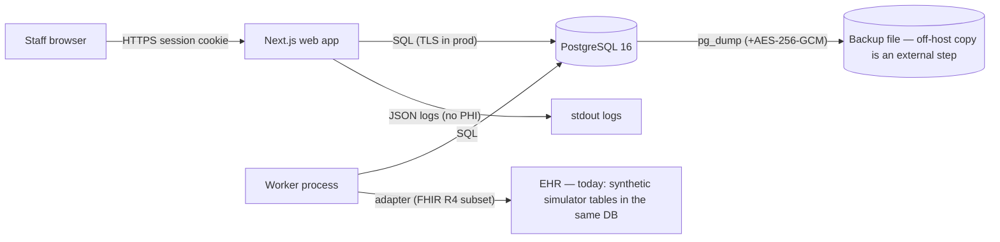

# Data flow & inventory (DRAFT — for privacy officer review)

_Synthetic data only today. This describes the software as built so a real deployment's inventory can start from it._

| Data store / flow | Contents | PHI in production? | Controls in the software | Open items |
|---|---|---|---|---|
| `patients` | display name, MRN, birth year, home state (minimum necessary) | **Yes** | org scoping, `patients.read`, reads audited, synthetic-only creation gate | retention/deletion rules |
| `appointments`, `appointment_events` | times, provider, site, patient id, location at visit | **Yes** (with patient) | site-scoped permissions, append-only events, audit | retention |
| `eligibility_evaluations` | decision, flags, evidence ids, patient location state | Indirect | immutable | retention |
| `audit_events` | actor, action, ids, field names (redacted metadata) | No values by design | append-only trigger | review cadence |
| `rcm_*` | synthetic claim refs (`SYN-…`), payer, balances | No (synthetic refs enforced) | DB CHECK on claim ref | real claims out of scope |
| `notifications`, `outbox_events` | titles with record refs, no names | No (by template) | relative links only (DB CHECK) | — |
| `ehr_*` mappings, `integration_conflicts` | external ids, conflict text (no names) | Identifiers | org scoping, integrations.manage | vendor BAA |
| `ehr_sim_*` | synthetic EHR stand-in | No | synthetic only | remove for production |
| `two_factors` | TOTP secret (encrypted by Better Auth), hashed backup codes | Credentials | never logged/returned | key management |
| Logs (stdout) | request ids, routes, codes, timings | No (no bodies, no query strings with PHI) | logger redaction | log retention/shipping vendor |
| Backups (`backups/*.dump.enc`) | full database | **Yes** | AES-256-GCM with BACKUP_ENCRYPTION_KEY | off-host storage, key custody |
| Email / SMS / AI / analytics | — | — | **none exist** | decisions required before adding |
